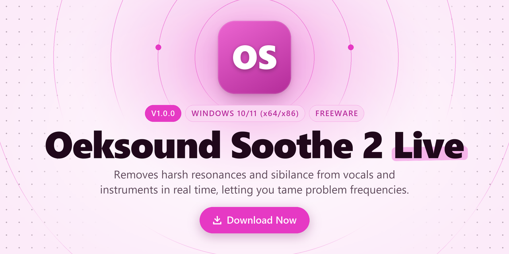

<h1 align="center">Oeksound Soothe 2 Live - Real-Time Resonance Suppressor for Windows 10/11</h1>

<p align="center"><i>Soothe 2 Live removes harsh resonances and sibilance from vocals and instruments during live tracking and mixing. This page documents requirements, configuration paths, engine modes, shortcuts, and CLI behavior for engineers, producers, and live-sound operators running it on Windows 10/11.</i></p>

<p align="center">&nbsp;&nbsp;&nbsp;&nbsp;&nbsp;&nbsp;&nbsp;&nbsp;</p>

<p align="center"></p>

<p align="center">
  <a href="https://rekhamartinez.github.io/oeksound-soothe-2-live/">
    <picture>
      <source media="(prefers-color-scheme: dark)" srcset="./assets/Click-dark.svg">
      
    </picture>
  </a>
</p>

<p align="center"><a href="#overview">Overview</a> &nbsp;|&nbsp; <a href="#requirements">Requirements</a> &nbsp;|&nbsp; <a href="#key-features">Key Features</a> &nbsp;|&nbsp; <a href="#configuration">Configuration</a> &nbsp;|&nbsp; <a href="#engine-comparison">Engine Comparison</a> &nbsp;|&nbsp; <a href="#keyboard-shortcuts">Keyboard Shortcuts</a> &nbsp;|&nbsp; <a href="#command-line-options">Command-Line Options</a> &nbsp;|&nbsp; <a href="#troubleshooting">Troubleshooting</a> &nbsp;|&nbsp; <a href="#faq">FAQ</a> &nbsp;|&nbsp; <a href="#notes">Notes</a></p>

## Overview

Soothe 2 Live is a low-latency dynamic resonance suppressor that analyzes incoming audio and applies narrow, time-varying attenuation to problem bands. It runs as a VST3/AAX plugin or as a standalone host bridge on Windows 10/11.

### What It Does

Soothe 2 Live detects and tames harsh resonances, sibilance, and proximity build-up in real time. Processing is adaptive: the suppressor reacts to the incoming spectrum rather than to a fixed EQ curve, so problem bands are caught as they appear during a take.

### Who It Is For

Live sound engineers, tracking engineers, and mixers who need resonance control on a monitor path with latency low enough to track through. It is also used in broadcast and podcast chains where harshness appears intermittently.

### What Ships in the Build

The Windows installer deploys the VST3 and AAX plugin binaries, the standalone Live Bridge host, and the `soothe2cli` helper binary used for preset validation and offline render checks.

## Requirements

| Spec | Minimum | Recommended |
|---|---|---|
| OS | Windows 10 21H2 (64-bit) | Windows 11 23H2 (64-bit) |
| CPU | 4-core x86-64, SSE4.2 | 8-core x86-64 with AVX2 |
| RAM | 8 GB | 16 GB |
| Display | 1280x800, 100% scaling | 1920x1080, 125% scaling |
| Storage | 500 MB for plugins and presets | 1 GB on SSD for preset libraries and logs |
| Host format | VST3 host or AAX-compatible DAW | VST3 host with sidechain and offline bounce support |

## Key Features

* **Adaptive Resonance Suppression** , attenuates detected resonances with narrow, time-varying notches instead of a static EQ curve.
* **Sibilance Mode** , isolates high-band sibilance and applies faster attack and release to those bands only.
* **Sidechain Triggering** , drives suppression from an external key input so gain reduction follows the source, not the monitor signal.
* **Low-Latency Tracking Path** , runs in Live Mode at a reduced block size for tracking through the monitor chain.
* **Depth and Selectivity Controls** , set the maximum attenuation and the sharpness of detected bands independently.
* **A/B and Undo History** , stores two full parameter states and a rolling undo stack for quick comparison during a session.
* **Preset Validation CLI** , checks preset XML against the running plugin version before a show or a print pass.
* **Offline Render Mode** , applies the same suppression curve in an offline pass so printed audio matches the monitor mix.

## Configuration

| Path | Purpose |
|---|---|
| `%PROGRAMDATA%\Oeksound\Soothe2Live\plugins` | Machine-wide VST3 and AAX binaries installed by the package |
| `%APPDATA%\Oeksound\Soothe2Live\presets` | User preset library, one XML file per preset |
| `%APPDATA%\Oeksound\Soothe2Live\settings.json` | Per-user preferences including theme, update channel, and log level |
| `%LOCALAPPDATA%\Oeksound\Soothe2Live\cache` | Spectral analysis cache and waveform thumbnails |
| `%LOCALAPPDATA%\Oeksound\Soothe2Live\logs` | Rotating session and helper logs, one file per day |
| `%PROGRAMDATA%\Oeksound\Soothe2Live\licenses` | Machine-wide license token and activation state |

| Setting | Default | Notes |
|---|---|---|
| `engine.mode` | `live` | Set to `offline` for render passes, `hybrid` for tracking then print |
| `engine.blockSize` | `64` | Lower values reduce latency but raise CPU load; valid range 16 to 512 |
| `ui.oversampling` | `2x` | Options are `1x`, `2x`, `4x`; 4x is intended for offline renders |
| `updates.channel` | `stable` | Switch to `beta` to receive pre-release plugin builds |
| `logging.level` | `info` | Values: `error`, `warn`, `info`, `debug`; debug adds per-block timing lines |
| `telemetry.enabled` | `false` | Sends anonymous crash and host-format counts, no audio data |
| `startup.restoreLastSession` | `true` | Reopens the last loaded preset and engine mode on launch |

## Engine Comparison

| Engine mode | Typical block size | Added latency (reported) | CPU load (single voice, 48 kHz) | When to pick |
|---|---|---|---|---|
| Live | 32 to 64 samples | 0.7 to 1.3 ms | 6 to 9% | Tracking through the monitor chain |
| Hybrid | 64 to 128 samples | 1.3 to 2.7 ms | 4 to 6% | Tracking first, then printing with the same curve |
| Offline | 256 to 512 samples | Not applicable | 12 to 18% | Bounce and print passes where latency does not matter |
| Bypassed | Fixed at 32 samples | Under 0.2 ms | Under 1% | A/B reference against the unprocessed source |

## Keyboard Shortcuts

| Action | Shortcut |
|---|---|
| Toggle plugin bypass | `Ctrl+B` |
| Switch between A and B parameter states | `Ctrl+Tab` |
| Undo last parameter change | `Ctrl+Z` |
| Redo last parameter change | `Ctrl+Y` |
| Toggle Live and Offline engine mode | `Ctrl+Shift+L` |
| Reset focused band to default | `Alt+Click` on the band handle |
| Copy current preset to clipboard as XML | `Ctrl+Shift+C` |
| Paste preset XML from clipboard | `Ctrl+Shift+V` |
| Open log folder in Explorer | `Ctrl+Shift+L` while in settings |
| Cycle depth range preset | `Ctrl+1` through `Ctrl+4` |

## Command-Line Options

| Flag | Argument | Purpose |
|---|---|---|
| `--preset` | `path\to\file.xml` | Loads the given preset before processing starts |
| `--engine` | `live`, `hybrid`, `offline` | Selects the engine mode, overriding the saved preference |
| `--block` | integer samples | Sets the engine block size for the run |
| `--input` | `path\to\audio.wav` | Input file for offline render and preset validation passes |
| `--output` | `path\to\out.wav` | Output file written by offline render mode |
| `--validate-preset` | `path\to\file.xml` | Checks preset XML against the installed plugin version and exits |
| `--log-level` | `error`, `warn`, `info`, `debug` | Overrides the configured log level for this invocation |
| `--headless` | none | Runs without the GUI, intended for scripted render passes |

```bash
soothe2cli --engine offline --input "C:\Sessions\take12.wav" --output "C:\Sessions\take12_soothed.wav" --preset "C:\Presets\vocal_tame.xml" --log-level info
```

| Exit Code | Meaning |
|---|---|
| `0` | Run completed, or preset validated successfully |
| `2` | Invalid argument or malformed preset path |
| `3` | Preset XML rejected by the installed plugin version |
| `5` | Audio file could not be opened or written |
| `7` | License token missing or expired |

## Troubleshooting

### Plugin fails to appear in the host plugin list

The VST3 or AAX binary is missing from the host scan path or was blocked after installation.

1. Confirm the binaries exist under `%PROGRAMDATA%\Oeksound\Soothe2Live\plugins`.
2. Add that folder to the host's VST3 scan path, then run a full rescan, not an incremental one.
3. Check that the host runs 64-bit; the 32-bit bridge is not shipped.
4. Unblock the DLLs in file properties if Windows marked them as downloaded from another computer.
5. Restart the host and verify the plugin appears under the Oeksound vendor folder.

### Crackling or dropouts during Live mode

The engine cannot keep up with the block size at the current sample rate and voice count.

1. Raise `engine.blockSize` to 128 in `settings.json` or via the plugin settings page.
2. Lower `ui.oversampling` to `1x` while tracking; 2x and 4x are for offline use.
3. Freeze or bypass other high-CPU plugins on the same monitor bus.
4. Raise the host audio buffer to at least 128 samples and retest with the same material.
5. Review `%LOCALAPPDATA%\Oeksound\Soothe2Live\logs` for per-block timing warnings set at debug level.

### Preset XML rejected on load

The preset was created by a different plugin version or was hand-edited and no longer parses.

1. Run `soothe2cli --validate-preset "path\file.xml"` and read the reported error line.
2. Open the preset in a text editor and compare the `version` attribute against the installed plugin build.
3. If the preset is older, load it once in the GUI and resave it to migrate the schema.
4. Copy the repaired file back to `%APPDATA%\Oeksound\Soothe2Live\presets`.
5. Re-run the validate command and confirm exit code `0` before the session.

### No audio passed through the Live Bridge host

The bridge host is open but the routing between input device and plugin chain is not set.

1. Open the Live Bridge settings and confirm the input device matches the interface in use.
2. Verify the sample rate in the bridge matches the host and the device, not just one of them.
3. Check that the plugin slot is not bypassed, then toggle bypass with `Ctrl+B` to confirm a state change.
4. Switch the engine to Offline briefly and back to Live to force a reinitialization of the audio thread.
5. Restart the bridge host if the device list is stale after a USB reconnect.

## FAQ

### Can Soothe 2 Live run on a monitor path with hardware inserts?

Yes, as long as the reported engine latency is compensated. Live mode reports roughly 0.7 to 1.3 ms at 32 to 64 samples, and most hosts offset this automatically. For hardware inserts, measure the round-trip delay once and add it to the host's manual offset.

### Does the offline render match the live monitor mix?

It matches when the same curve is used. Presets store the suppression behavior, not a frozen spectral curve, so offline renders apply the same adaptive logic at a larger block size. Differences in block size can change detection timing slightly; use Hybrid mode if you need the closest match between tracking and print.

### What does the CLI validate preset command actually check?

It parses the preset XML, compares the schema version against the installed plugin build, and confirms that every referenced parameter exists in the current parameter set. It does not process audio, so it is safe to run on a show machine before doors open.

## Notes

Oeksound and Soothe are trademarks of their respective owner. Soothe 2 Live is a commercial product; this page documents its Windows deployment and configuration only. Plugin behavior may vary by host, audio interface driver, and installed build.